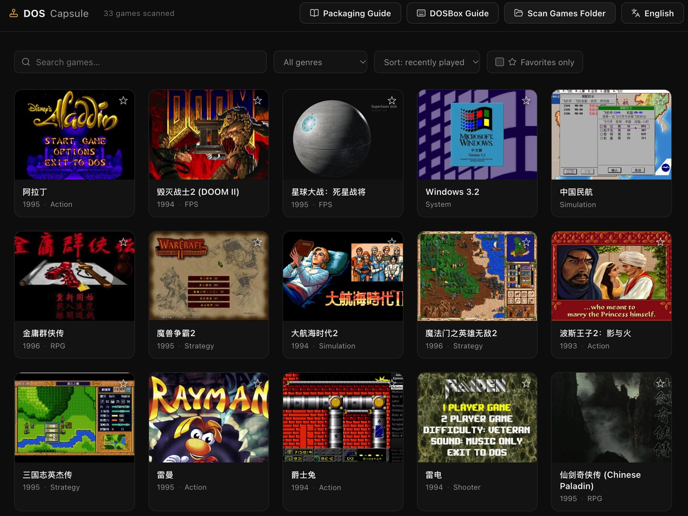

# DOS Capsule

**English** · [中文](README-CN.md)

A DOS game launcher written in Go.

Every DOS frontend out there had something I did not want — some need a network,
some drag in a pile of dependencies, some treat your own game collection as their
content library. So I wrote one: point it at your DOS games folder and it lays
them out as a wall of covers with years and genres, one click to play.



## Install

DOSBox Staging is required. **The package managers below install it for you.**

**macOS (Homebrew)**
```bash
brew tap bytecapsule/doscapsule https://github.com/bytecapsule/doscapsule
brew trust bytecapsule/doscapsule
brew install bytecapsule/doscapsule/doscapsule
```

**Windows 10/11 (Scoop)**
```powershell
scoop bucket add bytecapsule https://github.com/bytecapsule/doscapsule
scoop install doscapsule
```

**Otherwise**: grab the zip for your platform from
[Releases](https://github.com/bytecapsule/doscapsule/releases) and install
`dosbox-staging` yourself (`brew install dosbox-staging`,
`scoop install dosbox-staging`, or <https://dosbox-staging.github.io/>).

To upgrade later:

```bash
brew update && brew upgrade doscapsule     # Homebrew
scoop update doscapsule                    # Scoop
```

## Getting started

**Install it → run it → pick the folder your DOS games live in.**

```bash
doscapsule              # opens your browser
```

Then click **Scan game folder** in the top bar and choose your DOS games
directory. The scan result, favourites and play history are saved, so next
launch picks up where you left off.

## What each game folder needs

The launcher never touches your game files, but each game folder needs a couple
of small metadata files so it knows what the game is called and how to start it:

```
your-games-folder/
└── DUKE3D/
    ├── @launcher.json      ← required, needs at least a title
    ├── play.bat            ← required, one line naming the executable
    ├── @dosbox.conf        ← optional, only for special settings
    ├── @cover.jpg          ← optional, cover art
    └── DUKE3D.EXE …        ← the game itself, left exactly as it is
```

### Both are files you create

**First file: `@launcher.json`** — name, year, genre

Create a text file named `@launcher.json` (note the leading `@`) in the game
folder:

```json
{ "title": "Duke Nukem 3D", "year": 1996, "genre": "FPS" }
```

**Second file: `play.bat`** — tells DOSBox which program to run

Also in the game folder:

```bat
@echo off
duke3d
```

`duke3d` here is the game's executable **without the `.exe`**. If the program is
`PRINCE.EXE` write `prince`; if it is `WOLF3D.EXE` write `wolf3d`.

> Watch the extension: Windows Notepad may save it as `.json.txt` / `.bat.txt`,
> and macOS TextEdit defaults to RTF. VS Code, or letting an AI write the file,
> avoids both traps.

**Full spec, every field and worked examples: [docs/game-integration.md](docs/game-integration.md).**

> 💡 That document can be handed to an AI as-is to convert a messy games folder
> into the layout above. The in-app **Game Integration** dialog also has a
> **Copy AI spec** button.

## The mouse got captured — how do I get it back

Once a DOS game grabs the mouse the cursor will not leave the window. That is
DOSBox behaving normally, not a freeze:

| Action | Keys |
|---|---|
| **Release / re-capture the mouse** | **⌘F10** (macOS) · **Ctrl+F10** (Windows/Linux) · middle mouse button |
| Toggle fullscreen | Alt+Enter |
| Quit DOSBox | ⌘F9 / Ctrl+F9, or just close the DOSBox window |

Closing the DOSBox window clears the card's **Running** badge within a few
seconds.

## Features

- Scans a local DOS games folder and reads covers, years, genres and summaries
- Search, filter by genre; sort by title, year, genre, or grouped by last played
- Favourites and play history survive a restart
- One click to launch — DOSBox is started for you
- Edit a game's DOSBox config right in the UI
- See what is running and stop it from the grid
- Chinese / English UI

## Development

Stack: Go (backend, with the frontend embedded via `go:embed`) plus
SolidJS / TypeScript / Vite.

```bash
make dist      # build the frontend into cmd/doscapsule/dist
make build     # build the binary for this platform
make test      # run the tests
make run       # build and run
make zip-arm   # package for macOS arm64
make zip-x64   # package for macOS x64
make help      # list every target
```

Architecture, API and the release pipeline: [docs/technical.md](docs/technical.md).

## License

[MIT](LICENSE)
